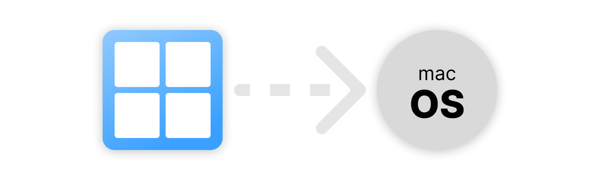

  <h3 align="center">I Bought a Mac</h3>

  
How I set up macOS as a long-time Windows and Linux user

 

  

    <a href="#history"><strong>History</strong></a>
    &middot;
    <a href="https://github.com/MatejMa2ur/macos-setup/issues/new?labels=bug">Report Bug</a>
    &middot;
    <a href="https://github.com/MatejMa2ur/macos-setup/issues/new?labels=enhancement">Request Feature</a>
  

<table>
  <tr>
    <td nowrap>&nbsp;<strong>For</strong></td>
    <td>Windows and Linux users moving to a Mac</td>
  </tr>
  <tr>
    <td nowrap>&nbsp;<strong>Covers</strong></td>
    <td>Installation, keyboard layout, customisation and tools</td>
  </tr>
  <tr>
    <td nowrap>&nbsp;<strong>Status</strong></td>
    <td>Notes, added as I go</td>
  </tr>
</table>

I was always a Windows or Linux user, but one nice afternoon I decided, that it would be nice to try Mac.  
So I bought one.

I would say, I was hardcore user of my laptop, and I love to have some kind of setup which I was using on all computers.  
So this repository is a documentation fo my hard work, to make macOS to my liking.

## History

- [Day 1 - Installation, Keyboard setup](/Pages/Day1-Installation,Keyboard.md)
- [Day 17 - Customization, Tools (Power Toys)](/Pages/Day17-Customization,Tools.md)
